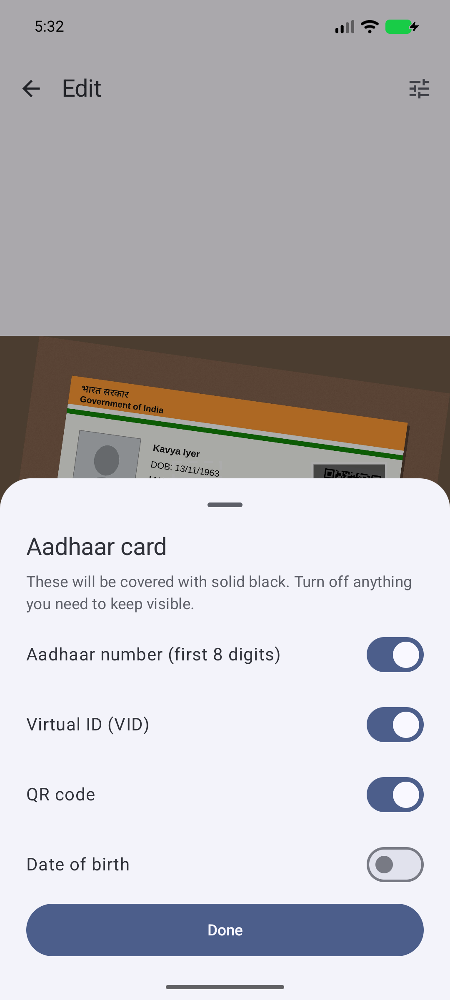
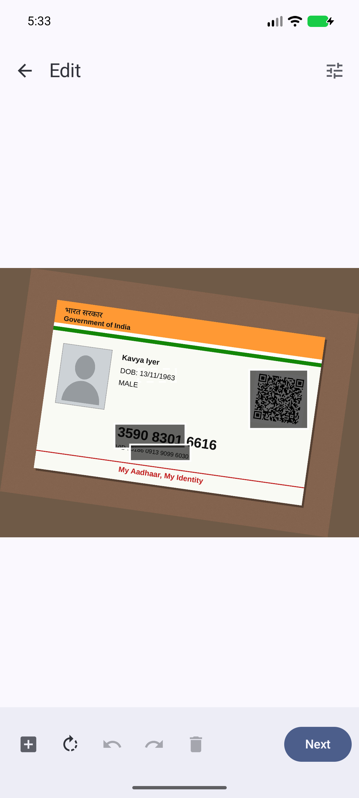

# SafeCopy

SafeCopy is an Android app for sharing a photo of your Aadhaar or PAN card without handing over everything on it. It covers the ID number and the QR code with black boxes, writes who the copy is for across the image, and saves a new JPEG with no location or camera data.

The app has no internet permission, so nothing you open in it can leave your phone.

<p>
  
  
  
</p>

The screenshots use made-up test cards.

## What it does

SafeCopy reads the photo on your phone and finds the Aadhaar number, VID, PAN and QR code. It covers the first 8 digits of an Aadhaar number and the first 6 characters of a PAN, so the copy looks like a masked Aadhaar. Settings can switch either to full masking. It also finds the date of birth and address but leaves them visible unless you turn them on.

You can draw your own boxes over anything else, such as the photo or signature, and move, resize or delete them. Undo works for every change.

The watermark repeats a line like `FOR SEA VIEW HOTEL KYC ONLY · 11 OCT 2026` across the whole image, over the black boxes too. A copy you gave a hotel then can't easily pass as one you gave a bank.

The saved file is drawn from scratch. It has no EXIF data, and the covered parts are solid black, not blurred.

Sideways photos are turned upright automatically. From WhatsApp, open the ID photo, tap Share, pick SafeCopy, then share the finished copy back.

SafeCopy isn't an official app and has no link to UIDAI, the Income Tax Department or any government body. It doesn't make a document valid or invalid, and some places will still ask for the full document. A watermark makes misuse harder and shows who a leaked copy came from, but someone could still edit it out.

## Install

Download `SafeCopy-1.0.0.apk` from the [latest release](https://github.com/sudhir45/SafeCopy/releases/latest), open it on your phone, and allow the install when Android asks. You need Android 8.0 or newer.

The APK is signed with this certificate. Check it with `apksigner verify --print-certs` if you want to be sure you have the real file:

```
63:F9:2C:DE:62:E2:20:83:19:25:B7:FC:0E:AA:39:27:4B:3D:81:32:80:C5:FB:A8:93:D3:83:53:FE:4A:B6:5A
```

## Privacy

- No internet permission. The build fails if a library tries to add one.
- No camera or storage permission. Photos come in through the system photo picker, your camera app, or Share.
- The original photo stays in memory while you edit. Temporary files are deleted after you share or save, when you discard, and the next time the app starts.
- Android blocks screenshots of the app and hides it in the recent-apps view.
- Settings and your last 10 recipient names stay on the phone and are left out of backups. Settings → Clear all data deletes them.

The full policy is in [docs/PRIVACY_POLICY.md](docs/PRIVACY_POLICY.md).

## Build

You need JDK 21 and the Android SDK.

```bash
git clone https://github.com/sudhir45/SafeCopy.git
cd SafeCopy
echo "sdk.dir=$HOME/Android/Sdk" > local.properties
./gradlew assembleDebug               # app/build/outputs/apk/debug/app-debug.apk
./gradlew testDebugUnitTest           # unit tests
./gradlew connectedDebugAndroidTest   # device tests, needs an emulator or phone
```

`scripts/check-permissions.sh <apk>` prints an APK's permissions and fails if it asks for network, camera or storage access. [docs/RELEASE.md](docs/RELEASE.md) covers signed release builds.

## Test images

Please don't put real ID photos in this repo or in an issue. The images in `app/src/androidTest/assets/fixtures/` are generated by `tools/fixtures/generate_fixtures.py` with made-up names and numbers. Use one of those, or cover the numbers first, when you report a problem.

## Licence

The code is under the [Apache License 2.0](LICENSE). The app includes Google ML Kit for text and QR recognition. ML Kit is closed source and covered by Google's [ML Kit terms](https://developers.google.com/ml-kit/terms), not by this licence, which also means the app can't go on F-Droid as it is.
