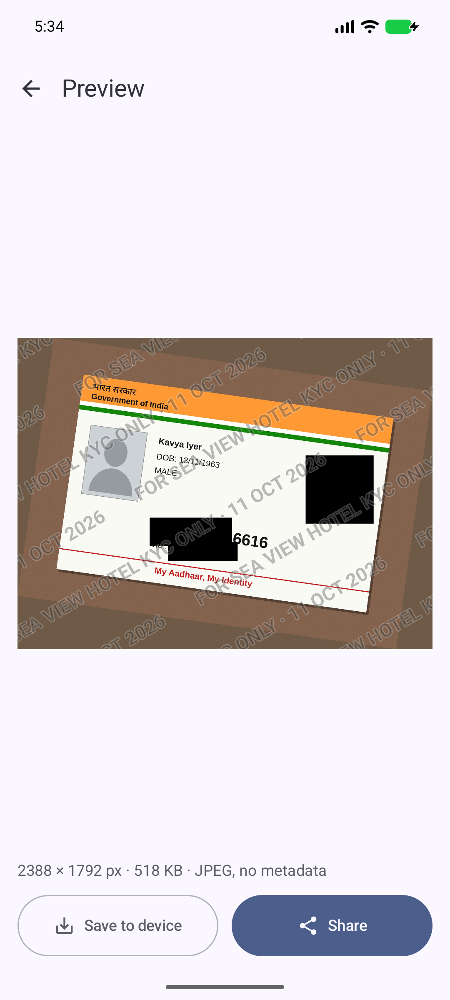

# SafeCopy

An offline Android app that turns a photo of an Indian ID card (Aadhaar, PAN) into a copy that's safer to share. It covers the sensitive numbers and the QR code with solid black boxes, stamps who the copy is for across the whole image, and saves it as a fresh JPEG with no hidden metadata.

**The app has no internet permission.** Your photos never leave your phone, and anyone can check that in the source or the APK.

<p>
  
  
  
</p>

_Screenshots use synthetic test cards. All names and numbers are made up._

## What it does

- **Finds and covers** the Aadhaar number (first 8 digits, or all 12), Virtual ID, PAN (first 6 characters, or all 10) and QR codes. Text recognition and QR detection run on the phone with Google ML Kit's bundled models. Date of birth and address are found too, but left visible unless you switch them on.
- **Lets you draw** extra boxes over anything else: photo, signature, address. Boxes can be moved, resized and deleted, with undo and redo.
- **Stamps a watermark** such as `FOR SEA VIEW HOTEL KYC ONLY · 11 OCT 2026`, tiled across the whole image and over the black boxes, so a copy given to a hotel can't easily be passed off as one given to a bank.
- **Saves a brand-new image.** The output is redrawn from scratch: no EXIF, no GPS, no phone model, and the covered pixels are solid black, not blurred.
- **Turns sideways photos upright** automatically.
- **Works from WhatsApp:** open the ID photo, tap Share, pick SafeCopy, then share the safe copy back.

SafeCopy is not an official app and is not affiliated with UIDAI, the Income Tax Department or any government body. It doesn't make a document valid or invalid, and an organisation may still ask for the full document. The watermark discourages misuse; it can't make a copy impossible to edit.

## Install

1. Download `SafeCopy-<version>.apk` from the [latest release](https://github.com/sudhir45/SafeCopy/releases/latest).
2. Open it on your phone and allow installs from your browser or file manager when Android asks.
3. Android 8.0 or newer is required.

To check the APK is genuine, compare its signing certificate with this SHA-256 fingerprint:

```
63:F9:2C:DE:62:E2:20:83:19:25:B7:FC:0E:AA:39:27:4B:3D:81:32:80:C5:FB:A8:93:D3:83:53:FE:4A:B6:5A
```

(`apksigner verify --print-certs SafeCopy-1.0.0.apk`, or the release page lists the file's SHA-256 checksum.)

## Privacy

- No `INTERNET` permission; the build fails if any library tries to add one.
- No camera or storage permissions: photos come in through the system Photo Picker, the camera app, or the share sheet.
- The original photo is held in memory only while you edit, and temporary files are deleted after sharing, on discard, and on the next app start.
- Screenshots and the recent-apps preview are blocked while the app is open.
- Settings and the last 10 recipient names are stored on the phone only and excluded from backups. **Settings → Clear all data** removes them.

Full text: [docs/PRIVACY_POLICY.md](docs/PRIVACY_POLICY.md).

## Build from source

Requirements: JDK 21 and the Android SDK (command-line tools are enough).

```bash
git clone https://github.com/sudhir45/SafeCopy.git
cd SafeCopy
echo "sdk.dir=$HOME/Android/Sdk" > local.properties
./gradlew assembleDebug            # app/build/outputs/apk/debug/app-debug.apk
./gradlew testDebugUnitTest        # 108 JVM tests
./gradlew connectedDebugAndroidTest  # 17 on-device tests (emulator or phone)
```

`scripts/check-permissions.sh <apk>` lists an APK's permissions and fails if a network, camera or storage permission is present.

Release signing reads `SAFECOPY_KEYSTORE`, `SAFECOPY_KEYSTORE_PASSWORD`, `SAFECOPY_KEY_ALIAS` and `SAFECOPY_KEY_PASSWORD` from `~/.gradle/gradle.properties` or the environment; see [docs/RELEASE.md](docs/RELEASE.md).

The full design is in [SAFECOPY_SPEC.md](SAFECOPY_SPEC.md), and [PROJECT_LOG.md](PROJECT_LOG.md) records every decision and test result along the way.

## Test data

Never put real ID photos in this repo or in an issue. The test images in `app/src/androidTest/assets/fixtures/` are synthetic, made by `tools/fixtures/generate_fixtures.py`. When reporting a problem, use one of those or a card with the numbers covered.

## Licence

SafeCopy's source code is licensed under the [Apache License 2.0](LICENSE).

The app bundles Google ML Kit (text recognition and barcode scanning), which is proprietary and distributed under the [ML Kit Terms of Service](https://developers.google.com/ml-kit/terms), not this licence. Because of that, the app can't be listed on F-Droid as is.
